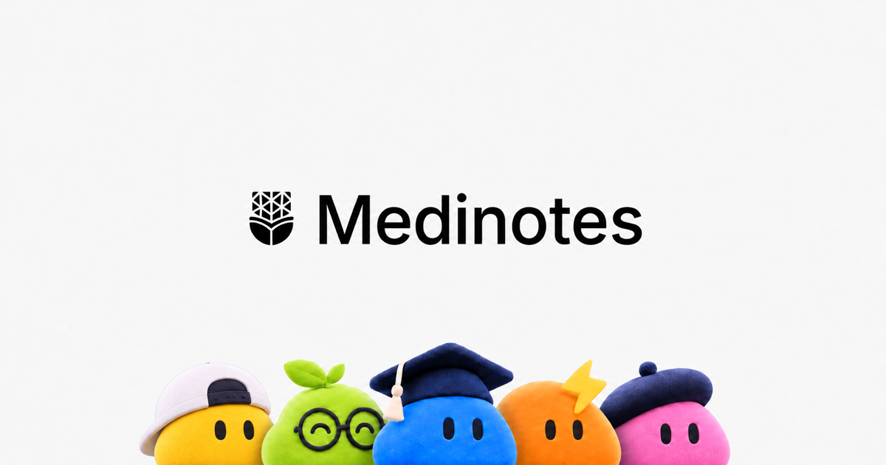

<div align="center">

  <a href="https://medinotes.in">
    
  </a>

  <br /><br />

  # 🐬 Medinotes Starter Template

  ### Modern Next.js Academic & Study Materials Portal Template
  
  A clean, responsive Next.js frontend template inspired by [**Medinotes.in**](https://medinotes.in).

  <br />

  [](https://medinotes.in)
  [](https://nextjs.org)
  [](https://react.dev)
  [](https://tailwindcss.com)
  [](https://www.typescriptlang.org)

</div>

---

## Overview

**Medinotes Starter** is an open-source, mobile-first frontend template for building student study portals, notes-sharing directories, and university academic repositories.

It comes pre-configured with:

- **Complete Homepage (`/`):** Fluid display typography, peekaboo mascot hero graphics, stats counter, and search bar.

- **Welcome Hub (`/welcome`):** Sidebar navigation, intro video banner, founders section, and animated resource cards.

- **Collapsible Program Sidebar:** University program tree (`config/courses.ts`) with expandable **B.Tech → CSE → 2nd Year** subjects.

- **Subject Page (`/notes`):** Tabbed **Notes**, **PYQs**, and **Syllabus** views for Data Structures (`/notes`), DBMS (`/notes?subject=dbms`), OOP (`/notes?subject=oop`), and Operating Systems (`/notes?subject=operating-systems`).

- **Instant Search Component:** Modal search across the 4 featured CSE 2nd Year subjects.

- **Dark / Light Theme System:** Circular view-transition theme toggle powered by `next-themes` and Tailwind CSS v4.

- **Mobile-First Design:** Responsive header with slide-out navigation drawer (`MobileCourseDrawer`).

---

## Quick Start Guide

Clone and run this template on your local machine in under 2 minutes:

### 1. Clone the Repository
```bash
git clone https://github.com/t4zn/medinotes.git
cd medinotes
```

### 2. Install Dependencies
Using **pnpm** (recommended):
```bash
pnpm install
```
Or using **npm** / **yarn** / **bun**:
```bash
npm install
# or
yarn install
# or
bun install
```

### 3. Run the Development Server
```bash
pnpm dev
```

Open [**http://localhost:3000**](http://localhost:3000) with your browser to see the result!

### 4. Build for Production
```bash
pnpm build
pnpm start
```

---

## Project Structure

```text
medinotes/
├── app/
│   ├── globals.css             # Tailwind CSS v4, theme tokens & view-transition animations
│   ├── layout.tsx              # Root layout wrapping SiteShell
│   ├── not-found.tsx           # 404 Page
│   ├── page.tsx                # Homepage (/)
│   ├── welcome/
│   │   └── page.tsx            # Welcome Hub (/welcome)
│   └── notes/
│       └── page.tsx            # Subject Detail Page (Notes, PYQs, Syllabus)
├── components/
│   ├── layout/                 # SiteShell (theme + chrome), Header (with theme toggle), SiteFooter
│   ├── home/                   # SubjectSearchModal
│   ├── welcome/                # HubHighlights + animated SVG cards CSS
│   ├── subject/                # CourseDetailView (live count + curriculum), PathTrail
│   ├── navigation/             # CourseSidebar (+ drawer state), ProgramTree (+ tree items/links)
│   └── ui/                     # Reusable Shadcn/Radix UI primitives
├── config/
│   └── courses.ts              # Sidebar navigation tree & course catalog (notes, PYQs, syllabus)
├── lib/
│   └── helpers.ts              # cn, toTitleCase & local mascot avatar helpers
├── public/
│   ├── favicon.ico
│   ├── mascot/                 # Local mascot WebP avatars (ryu, daisy, chilli, bud)
│   ├── media/                  # Local welcome hub intro video (mp4)
│   └── images/
│       ├── brand/              # Medinotes logos
│       ├── branding/           # Video poster
│       ├── founders/           # Team avatars
│       ├── hero/               # Light & Dark peekaboo hero graphics
│       └── social/             # Open Graph banner
├── next.config.mjs
├── package.json
├── postcss.config.mjs
├── tsconfig.json
└── README.md
```

---

## Customization Guide

### 1. Edit Sidebar & Subjects
To add or modify programs, branches, and subjects, edit:
- `config/courses.ts` (`NAVIGATION_TREE` and `COURSE_CATALOG`)

### 2. Changing Branding & Assets
- Replace logos in `public/images/brand/` (`medinotes-logo.svg`, `medinotes-logo-light-theme.svg`).
- Replace hero images in `public/images/hero/`.
- Update site metadata and descriptions in `app/layout.tsx` and `app/page.tsx`.

---

## Official Links

- **Live Medinotes Platform:** [**https://medinotes.in**](https://medinotes.in)
- **Repository:** [**https://github.com/t4zn/medinotes**](https://github.com/t4zn/medinotes)

---

<div align="center">
  <sub>Open-sourced with ❤️ by the Medinotes Team. Visit <a href="https://medinotes.in"><strong>medinotes.in</strong></a></sub>
</div>
